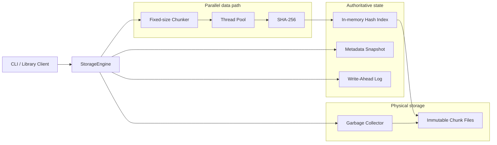
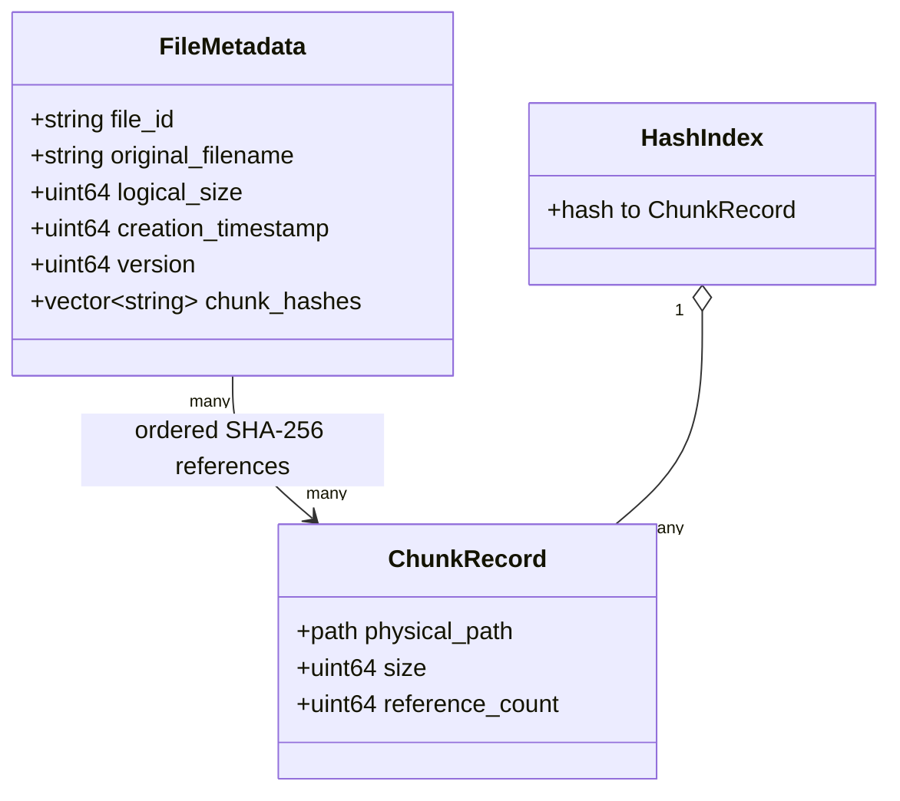
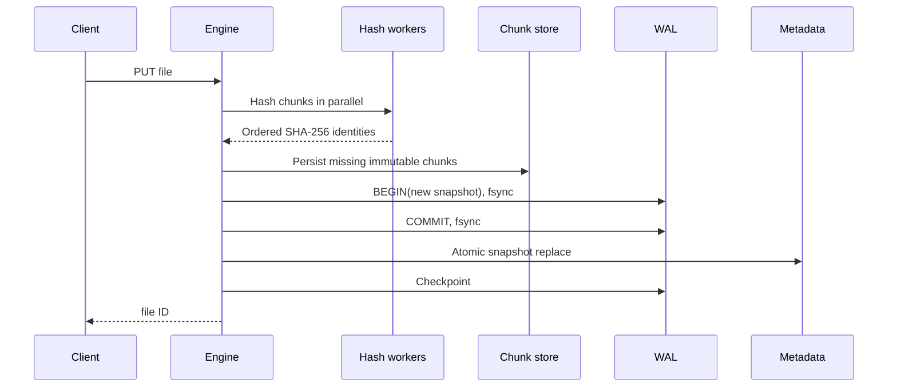
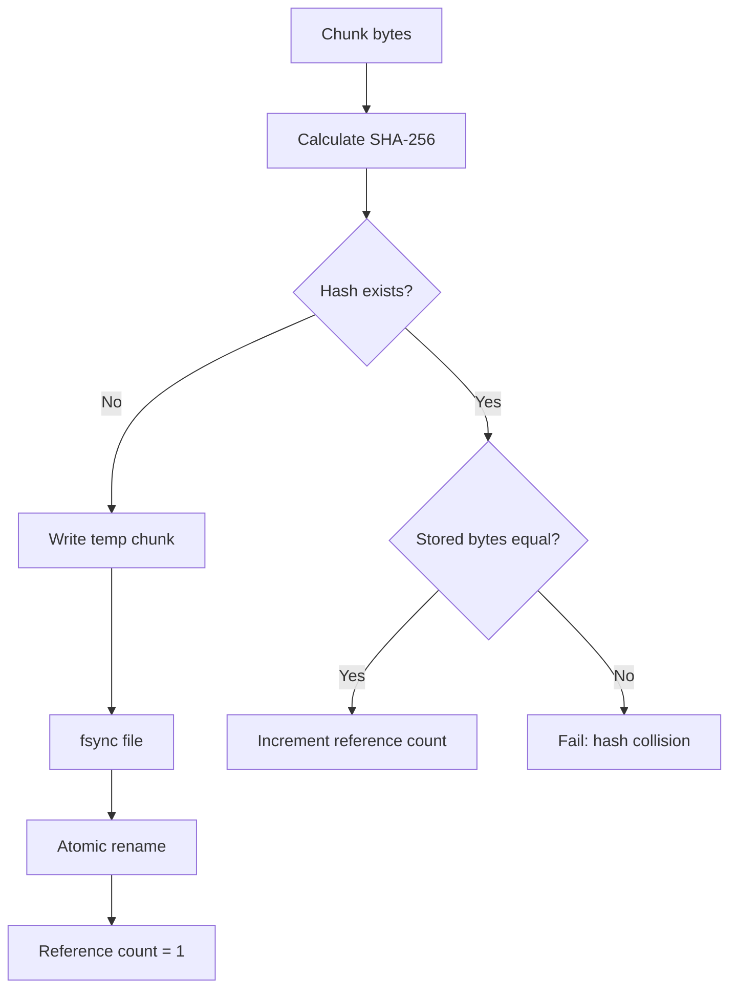
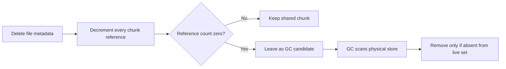
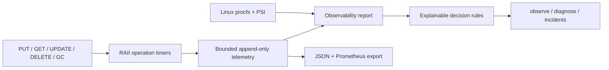

# FlashForge

FlashForge is a single-node, content-addressed, deduplicating storage engine written in modern C++20. It stores files as ordered 4 KiB chunks, persists each unique chunk once, tracks logical objects and reference counts, detects corruption during reads, and recovers committed metadata changes after a crash. It is deliberately small enough to explain at a whiteboard while exercising real storage-engine concerns: durability ordering, copy-on-write, checksums, garbage collection, concurrency, and I/O scaling.

> **Project status:** complete and runnable. The clean CMake build passes, all 23 test scenarios pass, and the CLI, recovery path, garbage collector, corruption detector, fail-open observability layer, decision engine, controlled WAL-delay experiment, and benchmarks have been exercised locally.

## Why FlashForge?

Traditional file storage writes every byte of every file, even when large regions are identical. FlashForge instead gives each chunk an identity derived from its contents:

```text
SHA-256(chunk bytes) = chunk identity = physical storage key
```

If ten logical files contain the same chunk, the engine stores one physical copy and records ten references. This cleanly separates the **logical namespace** users see from the **physical chunk store** the engine manages.

The project is intentionally focused on the storage data path rather than networking or distributed consensus. Its purpose is to make these systems concepts concrete:

- content addressing and deduplication;
- immutable data and copy-on-write updates;
- logical versus physical capacity;
- WAL ordering, `fsync`, atomic rename, and redo recovery;
- reference counting and safe garbage collection;
- checksums, torn writes, and corruption detection;
- parallel hashing, thread pools, locking, and race prevention.

## Contents

- [Build and use](#build-and-use)
- [CLI reference](#cli-reference)
- [Architecture](#architecture)
- [Core data model](#core-data-model)
- [On-disk layout](#on-disk-layout)
- [Chunk and object lifecycle](#chunk-and-object-lifecycle)
- [WAL and crash recovery](#wal-and-crash-recovery)
- [Integrity and reads](#integrity-and-reads)
- [Concurrency and locking](#concurrency-and-locking)
- [Garbage collection](#garbage-collection)
- [Statistics](#statistics)
- [Integrated observability and engineering decisions](#integrated-observability-and-engineering-decisions)
- [Benchmark](#benchmark)
- [Tests](#tests)
- [Interview discussion guide](#interview-discussion-guide)
- [Limitations and next steps](#deliberate-limitations-and-next-steps)

## Build and use

### Requirements

- CMake 3.16 or newer
- A C++20 compiler (AppleClang, Clang, or GCC)
- POSIX filesystem APIs (`fsync`, atomic same-filesystem `rename`)
- pthreads

There are no third-party runtime or test dependencies. SHA-256, CRC-32, the thread pool, and the lightweight test harness are included in the repository.

```bash
cd flashforge
mkdir build && cd build
cmake ..
cmake --build . -j
ctest --output-on-failure

./flashforge --data ./store put ../samples/file1.bin
./flashforge --data ./store list
./flashforge --data ./store stats
./flashforge --data ./store get ff-1 restored.bin
./flashforge --data ./store update ff-1 ../samples/file2.bin
./flashforge --data ./store delete ff-1
./flashforge --data ./store gc
```

The default data directory is `./data`; `--data` makes tests and multiple stores explicit. Enable ASan/UBSan with `cmake -DFLASHFORGE_SANITIZE=ON ..`.

Generate a repeatable, visibly deduplicating demo:

```bash
./scripts/create_demo_data.sh samples
./build/flashforge --data demo-store put samples/file1.bin
./build/flashforge --data demo-store put samples/file2.bin
./build/flashforge --data demo-store put samples/file3.bin
./build/flashforge --data demo-store stats
```

A successful demonstration shows logical storage larger than physical storage. The local acceptance run stored **917,504 logical bytes** using **327,680 physical bytes**, saving **589,824 bytes** for a **2.80x deduplication ratio**. Treat this as a functional demonstration, not a portable performance result.

## CLI reference

| Command | Purpose | Example |
|---|---|---|
| `put` | Store a new logical file and return its ID | `flashforge --data store put image.bin` |
| `get` | Reconstruct and checksum-verify a file | `flashforge --data store get ff-1 restored.bin` |
| `update` | Publish a copy-on-write version | `flashforge --data store update ff-1 image-v2.bin` |
| `delete` | Remove metadata and decrement references | `flashforge --data store delete ff-1` |
| `list` | List IDs, sizes, versions, and names | `flashforge --data store list` |
| `stats` | Show logical/physical usage and dedup savings | `flashforge --data store stats` |
| `gc` | Reclaim unreferenced physical chunks | `flashforge --data store gc` |

All failures return a non-zero exit code and a meaningful message. Library callers receive typed exceptions such as `FileNotFoundException`, `ChunkCorruptionException`, `WALException`, and `MetadataException`.

## Architecture



The interfaces are separated so a content-defined chunker can replace `FixedSizeChunker` without changing metadata or storage. SHA-256 is implemented in-tree to avoid a runtime dependency. Hashing is parallel; metadata ordering follows chunk indexes, so completion order cannot reorder a file.

### Component responsibilities

| Component | Responsibility |
|---|---|
| `StorageEngine` | Coordinates transactions, locks, recovery, API operations, and invariants |
| `FixedSizeChunker` | Streams an input into independently addressable 4 KiB chunks |
| `ThreadPool` | Runs SHA-256 work concurrently and returns ordered futures |
| `HashIndex` | Maps hash to path, size, and live reference count |
| `MetadataStore` | Serializes the logical namespace and atomically publishes snapshots |
| `WriteAheadLog` | Durably records intended state and commit decisions before publication |
| Garbage collector | Deletes only chunks absent from the locked live set |
| Checksum module | Provides SHA-256 content identity and CRC-32 WAL frame validation |

### Repository layout

```text
flashforge/
├── CMakeLists.txt
├── README.md
├── include/                 # Public interfaces and error types
├── src/                     # Engine implementation and CLI
├── tests/test_main.cpp      # 23 isolated functional/race/recovery/observability scenarios
├── benchmark/benchmark.cpp  # Real 1–32 worker benchmark
└── scripts/create_demo_data.sh
```

## Core data model



The ordered hash list is the file. Reconstructing a logical object means reading and verifying those immutable chunks in order. Duplicate hashes may appear more than once within one file, and every occurrence contributes one reference.

### Storage invariants

These are the rules the engine preserves across every successful operation:

1. Every hash referenced by committed metadata has a corresponding physical chunk.
2. A physical chunk's bytes hash to its filename.
3. A chunk reference count equals its number of occurrences across all live file metadata.
4. Metadata publication is atomic: readers observe the complete old snapshot or complete new snapshot.
5. A committed WAL transaction is replayable until its metadata snapshot is durable.
6. GC deletes only hashes outside the live set while holding the exclusive state lock.

## On-disk layout

```text
store/
├── metadata.bin
├── wal.log
└── chunks/
    └── ab/cd/abcdef...  # full SHA-256 name
```

Chunk fan-out avoids a single enormous directory. A chunk is written to a same-directory temporary file, `fsync`ed, atomically renamed, then its directory is `fsync`ed. Chunks are immutable. If a destination hash already exists, FlashForge compares the complete bytes; a differing payload is reported as a hash collision rather than silently deduplicated.

Metadata records a stable file ID, original name, logical size, creation timestamp, monotonically increasing version, and ordered chunk hashes. Its binary format has a magic/version marker and length-delimited fields. Persistence uses temporary-file + `fsync` + atomic rename + directory `fsync`, so readers see either the old or new complete snapshot.

### Why fan-out directories?

A flat directory containing millions of chunk files becomes expensive to enumerate and manage on many filesystems. The first four hexadecimal characters of the hash create two directory levels while the full hash remains the filename. This preserves content-addressed lookup without requiring a separate physical-location database.

## Chunk and object lifecycle



### Deduplication decision



Content addressing makes equality testing cheap: equal chunk hashes identify a candidate physical chunk and a full-byte comparison protects collision correctness. Logical size sums user-visible file sizes; physical size sums live unique chunks. Their ratio is the reported deduplication ratio.

An update is copy-on-write: new chunks are persisted first, unchanged hashes are reused, new references are added, old references are decremented, and one new metadata snapshot publishes the version. Existing chunk bytes are never overwritten. Delete removes the object and decrements every occurrence of its hashes. Zero-reference data remains physically present until GC, making deletion cheap and providing a clean crash boundary.

GC runs under the engine's exclusive state lock. It builds the live hash set from positive reference counts, scans the chunk tree, and removes only files absent from that set. This also reclaims orphan chunks left by a crash before metadata commit. Temporary files are ignored. Empty fan-out directories are harmless.

## WAL and crash recovery

Each WAL frame has a magic value, record type, transaction ID, payload length, CRC-32, and payload. A transaction's `BEGIN` contains the complete intended metadata snapshot. `COMMIT` makes it redoable. Both records are appended and `fsync`ed before `metadata.bin` is replaced. On startup, FlashForge scans valid complete frames, ignores a torn tail or uncommitted transaction, replays the latest committed snapshot atomically, then checkpoints the WAL.

```mermaid
stateDiagram-v2
    [*] --> OldMetadata: transaction starts
    OldMetadata --> ChunksDurable: persist missing chunks + fsync
    ChunksDurable --> BeginDurable: WAL BEGIN(snapshot) + fsync
    BeginDurable --> CommitDurable: WAL COMMIT + fsync
    CommitDurable --> MetadataDurable: temp metadata + fsync + rename + dir fsync
    MetadataDurable --> Checkpointed: truncate + fsync WAL
    Checkpointed --> [*]: return success

    OldMetadata --> RecoverOld: crash
    ChunksDurable --> RecoverOld: crash; orphan chunks are safe
    BeginDurable --> RecoverOld: crash; no COMMIT
    CommitDurable --> RedoSnapshot: crash; replay committed snapshot
    MetadataDurable --> RedoOrUseMetadata: crash
```



The guaranteed states are:

- Crash before WAL commit: old metadata remains authoritative; newly written chunks are harmless orphans and GC may reclaim them.
- Crash after WAL commit but before/during metadata rename: startup redoes the committed snapshot.
- Crash after metadata rename: either the WAL remains replayable or the durable metadata snapshot is already authoritative.
- Torn/corrupt WAL tail: parsing stops at the last checksum-valid complete record.

This is synchronous durability: successful mutating calls have forced chunks, WAL commit, and metadata to stable storage. It assumes normal POSIX `fsync` and same-filesystem atomic rename semantics. It does not defend against a disk that lies about flushes, simultaneous processes opening the same store, media loss, or corruption of `metadata.bin` when no committed WAL remains. Production evolution would add dual/checksummed metadata superblocks and inter-process locking.

### Why both `fsync` and atomic rename?

Atomic rename prevents readers from seeing a partially overwritten metadata file, but atomicity alone does not guarantee durability after power loss. `fsync` forces file contents toward stable storage; syncing the containing directory makes the renamed directory entry durable. The WAL supplies redo information for the interval between committing the intended snapshot and publishing it as `metadata.bin`.

## Integrity and reads

Every read recomputes SHA-256 and compares it with the content address before returning bytes. A mismatch throws `ChunkCorruptionException`; output is written to a temporary file, so a failed read does not publish a partial destination. SHA-256 serves as both identity and an end-to-end content checksum. The WAL separately uses CRC-32 for fast framing/torn-write detection.

## Concurrency and locking

The thread pool uses a task queue, mutex, condition variable, futures, and RAII worker shutdown. Chunk file reading and SHA-256 hashing occur before acquiring the engine state lock. Operations then use a `std::shared_mutex`:

- GET/list/stats take a shared lock. GET retains it through validation and reconstruction, so delete or GC cannot remove a chunk mid-read.
- PUT/update/delete/GC take an exclusive lock for index and metadata publication.
- WAL owns its append mutex; thread-pool queueing owns a separate mutex.

This avoids a lock around CPU-heavy input chunking/hashing and permits concurrent reads. Mutations serialize at the commit point because this snapshot-based metadata format has one publication stream. It prevents PUT+PUT ID races, PUT+DELETE reference races, torn UPDATE+GET observations, and GC+PUT deletion races. A higher-throughput design could add striped per-object locks, sharded index locks, group commit, and an LSM/B-tree metadata store; doing so would make lock ordering and transaction conflict handling substantially more complex.

### Operation compatibility

| Operation | Lock | Can overlap safely with |
|---|---|---|
| Input chunking / hashing | No state lock | All operations |
| GET | Shared | GET, list, stats |
| list / stats | Shared | GET, list, stats |
| PUT publication | Exclusive | Nothing at commit point |
| update / delete | Exclusive | Nothing at commit point |
| GC sweep | Exclusive | Nothing during live-set scan and deletion |

The coarse publication lock is a conscious correctness-first choice, not an accidental global mutex around the whole pipeline. Expensive input reading and hashing remain outside it, while readers share it.

## Garbage collection

Deletion is logically immediate but physically deferred:



Deferral keeps the transactional path simple: the engine never needs to make metadata publication and physical deletion atomic together. It also lets GC reclaim chunks orphaned by a process crash after chunk persistence but before transaction commit.

## Statistics

`stats` reports:

- **Logical storage:** sum of live logical file sizes.
- **Physical storage:** sum of unique, positively referenced chunk sizes.
- **Space saved:** `max(logical - physical, 0)`.
- **Dedup ratio:** `logical / physical`.
- **Unique chunks:** number of live physical identities.
- **Chunk references:** total hash occurrences across live files.
- **Files:** number of logical objects.

Physical bytes waiting for GC are intentionally excluded from live physical statistics but are reported as reclaimed bytes when GC runs.

## Integrated observability and engineering decisions

FlashForge includes a native observability layer in the same C++ binary. It does more than expose counters: it correlates operation latency, hashing time, durable commit time, dedup behavior, corruption events, garbage collection, filesystem capacity, and Linux pressure signals into explainable engineering recommendations.



Telemetry is deliberately outside the correctness path. Operation completion only attempts to enqueue a sample into a fixed-capacity in-memory queue; it never performs telemetry disk I/O. A background thread drains samples in batches, exceptions are contained, and metrics are stored under `data/observability/` rather than in the storage WAL. When the queue is full or persistence fails, samples are dropped and `flashforge_telemetry_samples_dropped_total` increases. A telemetry failure therefore cannot fail a storage operation or corrupt authoritative metadata. The local history is bounded to 10,000 samples and compacted automatically. Set `FLASHFORGE_OBSERVABILITY=0` to measure the engine with collection disabled.

### Commands

```bash
# Human-readable latency, reliability, capacity, and current diagnosis
./flashforge --data ./store observe

# Evidence-backed engineering recommendations only
./flashforge --data ./store diagnose

# Active reliability findings (same decision model, incident-oriented output)
./flashforge --data ./store incidents

# Machine-readable integrations
./flashforge --data ./store metrics --format json
./flashforge --data ./store metrics --format prometheus
```

The layer records operation count, failures, bytes, p50/p95/p99 latency, hashing time, dedup hits/misses, checksum failures, and GC reclamation. The durability path is split into WAL write, WAL `fsync`, metadata write, metadata `fsync`, atomic rename, and directory `fsync` timing. On Linux it additionally reads process RSS and I/O, open file descriptors, filesystem capacity, and kernel PSI I/O/memory pressure from `/proc`; unavailable platform signals are reported honestly rather than synthesized. PSI represents task stall pressure, not disk utilization, and the diagnostics deliberately preserve that distinction.

### From signals to decisions

| Correlated evidence | Diagnosis | Recommended decision |
|---|---|---|
| High PUT p99 and WAL synchronization dominates | WAL synchronization is the likely contributor, not proof of disk saturation | Inspect the sync and block-device path; more hash workers are unlikely to help |
| High PUT p99 and hashing dominates | CPU hashing bottleneck | Increase workers only while CPU headroom exists |
| PUT failure rate above 5% | Reliability incident | Inspect capacity, permissions, and WAL errors before retrying traffic |
| Checksum failure | Stored data corruption | Quarantine data and run an integrity scrub |
| Dedup hit ratio below 10% after enough chunks | Low workload locality | Evaluate content-defined chunking before adding capacity |
| Filesystem below 10% free | Capacity incident | Run GC, review retention, or add capacity |
| Linux PSI I/O pressure above 20% | Sustained I/O contention | Inspect device latency and rate-limit background GC |

Each result contains severity, diagnosis, concrete evidence, confidence, and a recommended action. Recommendations never execute operational changes: FlashForge does not automatically change worker counts, pause GC, remove suspected corrupt chunks, or weaken durability. The rules are deterministic and unit tested, so an engineer can audit why a recommendation was made.

### Reproducible WAL bottleneck experiment

The test-only fault injector delays each WAL synchronization when `FLASHFORGE_FAULT_WAL_FSYNC_DELAY_MS` is set. It is disabled by default, recorded in telemetry, and disclosed in diagnosis output.

```bash
./scripts/demo_slow_wal.sh ./build/flashforge
```

The script runs three isolated stores:

```text
normal workload
  -> inject 100 ms before WAL fsync
  -> observe PUT and WAL fsync latency rise together
  -> receive a likely-cause diagnosis with evidence
  -> remove injection
  -> verify latency returns toward baseline
```

This demonstrates correlation, not false certainty. A slow WAL `fsync` identifies the synchronization stage contributing latency; proving physical disk saturation would additionally require block-device latency, queue-depth, and throughput evidence.

### Measuring observability overhead

```bash
./build/flashforge_observability_benchmark 16
```

The benchmark runs the same deterministic PUT workload three times with observability disabled and three times enabled, reports each real measurement as CSV, then calculates median overhead. Results are intentionally not hard-coded: filesystem cache state, storage hardware, durability latency, workload size, and scheduling materially affect them. Small durability-heavy workloads can exaggerate percentage overhead, so report the workload and raw trials with any result.

## Benchmark

`flashforge_benchmark [MiB=64] [files=8]` creates a deterministic workload with shared and unique 4 KiB regions, then actually measures sequential PUT runs using 1, 2, 4, 8, 16, and 32 hash workers. It prints CSV fields:

```text
threads,throughput_mb_s,latency_ms,files_per_sec,dedup_ratio,physical_bytes
```

No results are embedded because CPU, filesystem cache, storage device, durability implementation, and thermal state materially affect them. For credible interview numbers, run multiple cold- and warm-cache trials, report median/p95, state whether durability is enabled, and retain the generated CSV. Scaling eventually flattens when synchronous filesystem/WAL latency or memory bandwidth—not SHA-256 compute—becomes the bottleneck.

## Tests

The dependency-free test executable uses unique temporary directories and covers round trips (empty, tiny, large, binary), duplicate files/chunks, partial deduplication, reference counts, delete/GC and live-data safety, copy-on-write update, corruption, restart persistence, committed and uncommitted WAL recovery, concurrent PUT/GET, PUT+DELETE, UPDATE+GET, and GET+DELETE races.

| Area | Representative assertions |
|---|---|
| Data correctness | Empty, tiny, large, and binary files round-trip byte-for-byte |
| Deduplication | Duplicate files, repeated chunks, and partially shared files consume expected physical space |
| Lifecycle | Delete updates counts; update preserves unchanged chunks; GC reclaims only dead chunks |
| Integrity | Manually corrupted chunk raises `ChunkCorruptionException` |
| Recovery | Committed WAL snapshot replays; uncommitted snapshot is ignored |
| Concurrency | Concurrent PUT/GET and PUT+DELETE, UPDATE+GET, GET+DELETE races preserve invariants |

## Interview discussion guide

### A concise two-minute explanation

> FlashForge splits files into fixed 4 KiB chunks and uses SHA-256 as each chunk's content address. Metadata stores an ordered list of hashes, so identical chunks across or within files share one immutable physical copy. Updates are copy-on-write: new chunks are made durable first, then one metadata snapshot atomically switches the logical file to its new version. A synchronous WAL records and commits that intended snapshot before atomic metadata replacement, allowing redo after a crash. Reference counts are rebuilt from authoritative metadata, and GC removes only chunks outside a locked live set. Parallel hashing happens in a reusable thread pool, while a shared mutex allows concurrent reads and serializes only state publication.

### Design questions worth discussing

| Question | FlashForge's answer | Production evolution |
|---|---|---|
| Why content addressing? | Equality, integrity, and physical identity use one stable key | Add content-defined boundaries for shifted data |
| What about hash collisions? | Verify complete stored bytes before deduplicating; reject mismatch | Collision buckets or secondary digest |
| Why immutable chunks? | Readers need no overwrite coordination; COW recovery is simpler | Segment packing for fewer small files |
| Why a WAL if rename is atomic? | Rename gives visibility atomicity; WAL provides redo across crashes | Group commit and bounded/checkpointed log |
| Why rebuild refcounts? | Metadata is one source of truth, avoiding dual-state divergence | Persisted transactional index for faster startup |
| Why defer deletion? | Keeps transaction commit separate from destructive physical I/O | Concurrent epoch/pin-based GC |
| Why does 32-thread scaling flatten? | Hashing stops dominating; sync I/O and memory bandwidth take over | Batch writes, io_uring, larger chunks, group commit |
| What durability is promised? | Successful mutations synchronously persist chunks, WAL, and metadata under POSIX assumptions | Replication and verified storage barriers |

### Complexity

For a file containing `n` bytes and `k = ceil(n / chunk_size)` chunks:

- chunking and hashing: `O(n)` work, parallelized across workers;
- dedup index lookup: expected `O(k)` total with the hash map;
- GET: `O(n)` reads and checksum work;
- metadata snapshot commit: `O(total metadata size)` in this implementation;
- GC: `O(number of physical chunks + number of live references)`.

## Deliberate limitations and next steps

- Fixed 4 KiB boundaries miss shifted-region deduplication; Rabin-fingerprint content-defined chunking is the natural next chunker.
- The full metadata snapshot and exclusive commit lock favor clarity over very large catalogs. A transactional B-tree/LSM index and group commit would improve scale.
- Refcounts are rebuilt from authoritative metadata at startup rather than stored independently, eliminating a second consistency problem but increasing startup cost.
- GC is stop-the-world with respect to mutations. Epoch/pin-based concurrent sweeping would shorten pauses.
- There is no compression, encryption, replication, network API, quotas, background scrubber, or multi-process writer coordination.
- SHA-256 collisions are handled by byte comparison and an explicit error; alternate collision buckets are not stored.

These boundaries are intentional: FlashForge focuses on the single-node data path and makes durability-versus-performance tradeoffs visible instead of hiding them behind distributed consensus.
